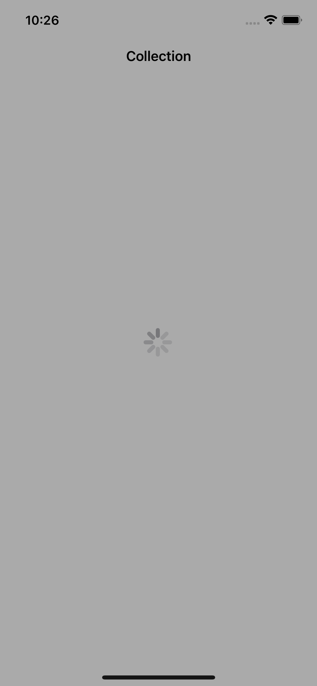
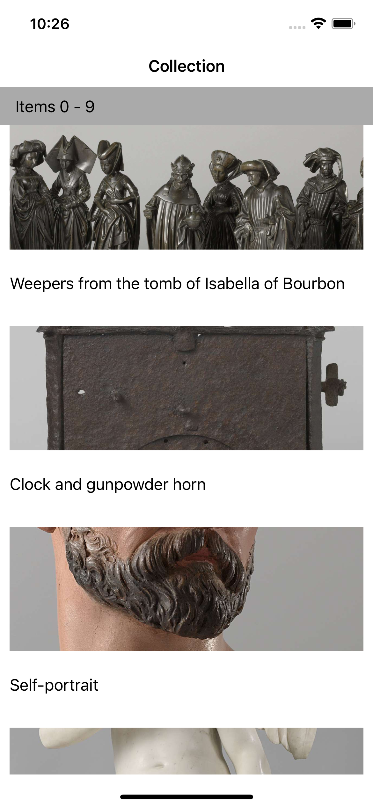
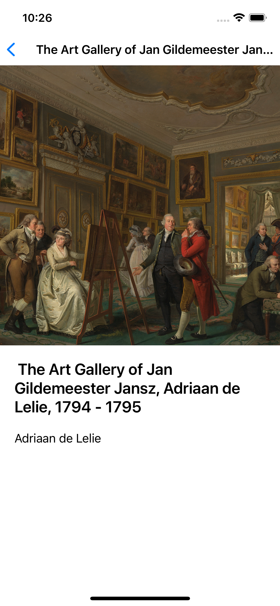

# RijksWonders

A beautiful iOS demo app showcasing art from the Rijksmuseum in the Netherlands.

## Overview

This project demonstrates essential iOS development patterns by fetching and displaying art collection data from the Rijksmuseum API. The app showcases clean architecture principles with a focus on maintainable, testable code.

## Features

- Browse art collections from the Rijksmuseum
- View detailed information about individual artworks
- Smooth image loading with caching
- Clean, intuitive user interface
- Comprehensive test coverage

## Architecture

The app follows **MVVM** and **CLEAN Architecture** principles with strict separation into layers:

```
Services ⬅ Models ⬅ ViewModels ⬅ View (the app itself)
```

Each layer can only depend on the layer directly below it, ensuring clean separation of concerns and testability.

## Dependencies

This project uses minimal external dependencies:
- [Kingfisher](https://github.com/onevcat/Kingfisher) - For lazy asynchronous image downloading and caching
- iOS SDK (vanilla implementation)

## Screenshots

| Loading | Collection View | Art Details |
|---------|----------------|-------------|
|  |  |  |
